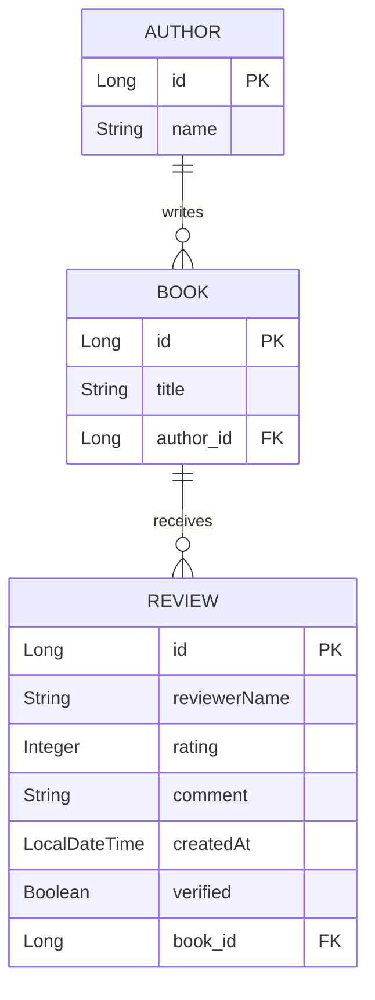
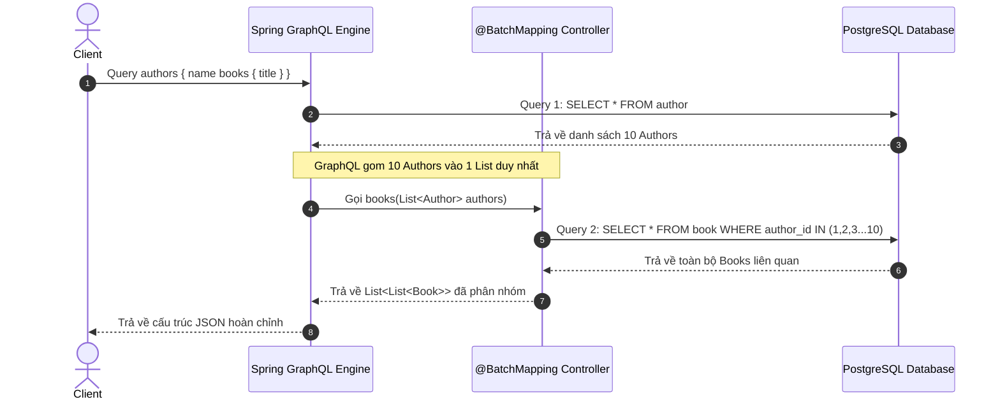
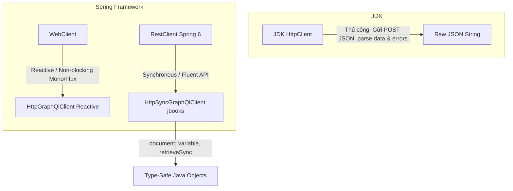
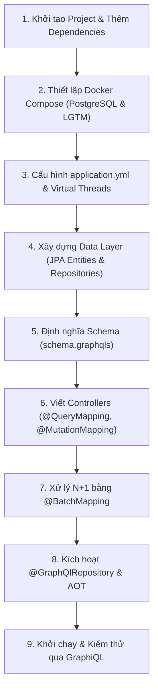

# Hướng Dẫn Toàn Diện Triển Khai Spring for GraphQL (Dự Án jbooks)

> **Tài liệu tham khảo & Hướng dẫn kỹ thuật chuyên sâu**  
> Dự án phân tích: `jbooks` (Spring Boot + Spring for GraphQL + Java 25 + Spring Data JPA + OpenTelemetry + Grafana LGTM + Virtual Threads).

---

## Mục Lục

1. [1. Tại Sao Lại Là GraphQL? (Why GraphQL?) & So Sánh Chi Tiết Với REST](#1-tại-sao-lại-là-graphql-why-graphql--so-sánh-chi-tiết-với-rest)
2. [2. Tạo Tầng Dữ Liệu (Creating the Data Layer)](#2-tạo-tầng-dữ-liệu-creating-the-data-layer)
3. [3. Lược Đồ GraphQL (The GraphQL Schema)](#3-lược-đồ-graphql-the-graphql-schema)
4. [4. Cơ Chế Thu Thập Dữ Liệu (Data Fetchers & Resolvers)](#4-cơ-chế-thu-thập-dữ-liệu-data-fetchers--resolvers)
5. [5. Kiểu Hợp Nhất (Unions) Trong GraphQL](#5-kiểu-hợp-nhất-unions-trong-graphql)
6. [6. Vấn Đề Truy Vấn N+1 & Sức Mạnh Của Virtual Threads](#6-vấn-đề-truy-vấn-n1--sức-mạnh-của-virtual-threads)
7. [7. Tích Hợp Dữ Liệu Nâng Cao: GraphQL Repository & AOT Repository](#7-tích-hợp-dữ-liệu-nâng-cao-graphql-repository--aot-repository)
8. [8. Tích Hợp Phía Client Với HttpSyncGraphQlClient](#8-tích-hợp-phía-client-với-httpsyncgraphqlclient)
9. [9. Giám Sát Chi Tiết (Observability: OpenTelemetry + Grafana LGTM)](#9-giám-sát-chi-tiết-observability-opentelemetry--grafana-lgtm)
10. [10. Hướng Dẫn Từng Bước Thiết Lập GraphQL Từ Đầu (Step-by-Step Setup Guide)](#10-hướng-dẫn-từng-bước-thiết-lập-graphql-từ-đầu-step-by-step-setup-guide)
11. [11. Tổng Kết Kiến Trúc & Công Nghệ (Conclusion)](#11-tổng-kết-kiến-trúc--công-nghệ-conclusion)

---

## 1. Tại Sao Lại Là GraphQL? (Why GraphQL?) & So Sánh Chi Tiết Với REST

### 1.1. Những hạn chế cố hữu của kiến trúc RESTful

Trong kiến trúc REST truyền thống:

- **Over-fetching (Thừa dữ liệu):** Endpoint `GET /api/books` trả về toàn bộ payload (id, title, author, description, isbn, publishDate, v.v.), ngay cả khi client (như màn hình mobile list) chỉ cần mỗi `title`. Điều này gây lãng phí băng thông mạng, tốn pin thiết bị và tài nguyên phân giải JSON.
- **Under-fetching (Thiếu dữ liệu) & Endpoint Chaining (Gọi nhiều API liên tiếp):** Giả sử giao diện cần hiển thị: Chi tiết Sách + Thông tin Tác giả + Các Đánh giá (Reviews). Với REST, client phải gửi 3 request độc lập:
  1. `GET /api/books/1`
  2. `GET /api/authors/2`
  3. `GET /api/books/1/reviews`
     Điều này làm tăng độ trễ mạng (latency round-trips), đặc biệt nghiêm trọng trên mạng di động 4G/5G không ổn định.
- **Endpoint Sprawl (Bùng nổ số lượng endpoint):** Mỗi yêu cầu giao diện mới lại dẫn đến việc tạo thêm endpoint như `/api/books/summary`, `/api/books-with-author`, `/api/v2/books` gây phân mảnh và khó bảo trì.

### 1.2. Giải pháp từ GraphQL

- **Single Endpoint duy nhất:** Mọi yêu cầu được gửi tới một endpoint duy nhất (thường là `POST /graphql`).
- **Client-Driven Data Queries:** Phía Client toàn quyền quyết định cấu trúc dữ liệu trả về bằng cú pháp truy vấn trực quan. Client cần trường nào thì server chỉ serialize trường đó.
- **Strongly Typed Schema Contract:** Schema đóng vai trò như một bản hợp đồng bất biến giữa Frontend và Backend. Cả hai phía có thể phát triển song song mà không sợ sai lệch dữ liệu.
- **Tích hợp sẵn GraphiQL:** Giao diện trực quan để kiểm thử, xem tài liệu tự động sinh (Doc Explorer) mà không cần cài thêm Swagger/Postman.

### 1.3. Bảng so sánh tổng quan REST vs GraphQL

| Tiêu chí            | REST API                                           | GraphQL API (như trong `jbooks`)                           |
| :------------------ | :------------------------------------------------- | :--------------------------------------------------------- |
| **Endpoint**        | Nhiều endpoints (`/books`, `/authors`, `/reviews`) | Duy nhất 1 endpoint (`POST /graphql`)                      |
| **Lấy dữ liệu**     | Server quy định cấu trúc trả về (Fixed payload)    | Client tự định nghĩa trường cần lấy (Flexible payload)     |
| **Hiệu năng mạng**  | Dễ bị Over-fetching hoặc Under-fetching            | Không thừa, không thiếu dữ liệu                            |
| **Số lần gọi mạng** | Thường cần nhiều round-trips cho dữ liệu lồng nhau | 1 request duy nhất gom toàn bộ quan hệ                     |
| **Đặc tả API**      | Cần OpenAPI/Swagger (dễ bị lệch pha với code)      | Schema SDL bắt buộc (`schema.graphqls`), tự sinh docs      |
| **Xử lý đa hình**   | Phức tạp (cần cấu hình Jackson discriminator)      | Hỗ trợ tự nhiên qua `Union` và `Interface`                 |
| **HTTP Caching**    | Rất mạnh mẽ ở tầng mạng (HTTP 200, 304, CDN)       | Cần caching ở tầng Application/Data (DataLoader/Apollo)    |
| **Mã lỗi**          | Dựa trên HTTP Status Codes (404, 400, 500)         | Luôn trả về HTTP 200, chi tiết lỗi nằm trong mảng `errors` |

---

## 2. Tạo Tầng Dữ Liệu (Creating the Data Layer)

### 2.1. Ngăn xếp công nghệ sử dụng trong `jbooks`

Dự án `jbooks` sử dụng ngăn xếp hiện đại nhất của Java và Spring:

1. **Java 25 & Records:** Tận dụng tính năng hiện đại của Java, dùng `record` cho DTO (`BookInput`, `ReviewFilter`, `AuthorsAndBooks`) giúp code bất biến (immutable), ngắn gọn và an toàn thread.
2. **Spring Data JPA & Hibernate 6+:** Quản lý ánh xạ đối tượng - quan hệ (ORM).
3. **PostgreSQL:** Cơ sở dữ liệu quan hệ mạnh mẽ, lưu trữ thực tế.
4. **Spring Boot Docker Compose (`spring-boot-docker-compose`):** Tự động phát hiện file `compose.yaml` khi ứng dụng khởi chạy, kích hoạt container PostgreSQL và Grafana-LGTM mà không cần người dùng thao tác lệnh Docker thủ công.
5. **Lombok:** Tự động sinh Getter, Setter, Constructors.

### 2.2. Cách dự án tổ chức dữ liệu

Cấu trúc quan hệ Entity trong dự án gồm 3 bảng chính: `Author`, `Book`, và `Review`.



#### Chi tiết triển khai mã nguồn:

- **`Author.java`:**

  ```java
  @Entity
  @Getter @Setter
  public class Author {
      @Id
      @GeneratedValue(strategy = GenerationType.IDENTITY)
      private Long id;
      private String name;

      @OneToMany(mappedBy = "author")
      private List<Book> books;
  }
  ```

- **`Book.java`:**

  ```java
  @Entity
  @Getter @Setter
  public class Book {
      @Id
      @GeneratedValue(strategy = GenerationType.IDENTITY)
      private long id;
      private String title;

      @ManyToOne(fetch = FetchType.LAZY)
      private Author author;
  }
  ```

- **`Review.java`:**

  ```java
  @Entity
  @Getter @Setter
  public class Review {
      @Id
      @GeneratedValue(strategy = GenerationType.IDENTITY)
      private Long id;
      private String reviewerName;
      private Integer rating;
      private String comment;
      private LocalDateTime createdAt;
      private Boolean verified;

      @ManyToOne(fetch = FetchType.LAZY)
      private Book book;
  }
  ```

### 2.3. Khởi tạo dữ liệu mẫu với `DataLoader.java`

Dự án sử dụng Spring `CommandLineRunner` để tự động chèn dữ liệu các tác giả nổi tiếng trong cộng đồng Spring (Josh Long, Mark Heckler, Greg Turnquist, Dan Vega, Craig Walls) cùng các đầu sách và đánh giá thực tế ngay khi app khởi động.

### 2.4. So sánh với REST ở Tầng Dữ Liệu

- **Trong REST thông thường:** Khi ánh xạ quan hệ hai chiều `@OneToMany` và `@ManyToOne` (như Author <-> Book), việc trả thẳng Entity qua `@RestController` sẽ dẫn đến lỗi kinh điển:
  - `JsonMappingException: Infinite recursion (StackOverflowError)` do Jackson serialize vòng lặp vô tận. Lập trình viên phải gắn `@JsonIgnore` hoặc `@JsonManagedReference` / DTO thủ công.
  - `LazyInitializationException` nếu session Hibernate đã đóng mà Jackson cố đọc thuộc tính `LAZY`.
- **Trong GraphQL:** Engine của GraphQL hoàn toàn giải quyết được vấn đề này! GraphQL duyệt dữ liệu theo cây truy vấn (Query AST). Nếu client chỉ hỏi `author { name }`, Hibernate không bao giờ phải load `books`. Nếu client hỏi `author { books { title } }`, DataFetcher tương ứng sẽ được gọi đúng lúc.

---

## 3. Lược Đồ GraphQL (The GraphQL Schema)

File schema tọa lạc tại: `src/main/resources/graphql/schema.graphqls`.

### 3.1. Phân tích chi tiết Schema trong dự án `jbooks`

```graphql
# 1. Các kiểu thao tác gốc (Root Operation Types)
type Query {
  books: [Book!]!
  book(id: ID): Book!
  search(text: String): [SearchItem]!
  authors: [Author!]!
  review(id: ID): Review
  reviews(filter: ReviewFilter): [Review]!
}

type Mutation {
  addBook(bookInput: BookInput): Book!
}

# 2. Các kiểu thực thể đối tượng (Object Types)
type Book {
  id: ID!
  title: String!
  author: Author
}

type Author {
  id: ID!
  name: String!
  books: [Book!]!
}

type Review {
  id: ID!
  rating: Int!
  comment: String
  createdAt: String!
  reviewerName: String!
  verified: Boolean!
  book: Book!
}

# 3. Kiểu đầu vào (Input Types)
input BookInput {
  title: String!
  authorId: Int!
}

input ReviewFilter {
  rating: Int
  verified: Boolean
  reviewerName: String
}

# 4. Kiểu hợp nhất (Union)
union SearchItem = Author | Book
```

#### Quy tắc cú pháp quan trọng:

- `ID!`: Dấu chấm than `!` biểu thị trường không được phép `null` (Non-null).
- `[Book!]!`: Một danh sách không bao giờ `null`, và mọi phần tử bên trong danh sách cũng không được phép `null`.
- `input` vs `type`: Trong GraphQL, `type` dùng cho dữ liệu trả về (Output), còn `input` chỉ được dùng làm đối số truyền vào (Input Arguments). Bạn không thể dùng `type` làm đối số cho Mutation hay Query.

### 3.2. Ví dụ mở rộng chuyên sâu (Extended Schema)

Trong các dự án thương mại thực tế, schema của `jbooks` có thể được mở rộng thêm:

1. **Phân trang (Pagination) theo chuẩn Relay Cursor hoặc Offset:**
2. **Thao tác thời gian thực (Subscriptions) qua WebSocket:**
3. **Custom Scalar (ví dụ `DateTime` thay vì `String`):**

```graphql
# MỞ RỘNG: Hỗ trợ thời gian thực (Real-time updates)
type Subscription {
  reviewAdded(bookId: ID!): Review!
}

# MỞ RỘNG: Phân trang chuẩn Relay Connection
type BookConnection {
  edges: [BookEdge!]!
  pageInfo: PageInfo!
  totalCount: Int!
}

type BookEdge {
  cursor: String!
  node: Book!
}

type PageInfo {
  hasNextPage: Boolean!
  endCursor: String
}
```

### 3.3. So sánh Schema GraphQL với OpenAPI/Swagger của REST

- **OpenAPI trong REST:** Thường là tài liệu bổ sung (Add-on). Lập trình viên viết code xong rồi generate Swagger, hoặc viết Swagger YAML rồi generate code. Rất dễ xảy ra tình trạng: code cập nhật nhưng quên sửa annotation Swagger, dẫn đến tài liệu sai lệch với thực tế.
- **GraphQL Schema:** Là thành phần bắt buộc (First-class citizen). Nếu bạn truy vấn một trường không có trong schema, request sẽ bị từ chối ngay ở bước **Schema Validation** trước khi đụng vào code Java.

---

## 4. Cơ Chế Thu Thập Dữ Liệu (Data Fetchers & Resolvers)

### 4.1. Cách dữ liệu được fetch trong Spring for GraphQL

Trong GraphQL Java, mỗi trường (field) trong schema được ánh xạ tới một `DataFetcher<T>`.  
Spring for GraphQL cung cấp mô hình lập trình dựa trên Annotation cực kỳ thanh lịch (tương tự Spring MVC):

| Annotation         | Ý nghĩa                                             | Phương thức Schema tương ứng                           |
| :----------------- | :-------------------------------------------------- | :----------------------------------------------------- |
| `@QueryMapping`    | Ánh xạ hàm Java với một field trong `type Query`    | Tự động bắt theo tên hàm hoặc chỉ định `name = "..."`  |
| `@MutationMapping` | Ánh xạ hàm Java với một field trong `type Mutation` | Dùng cho các thao tác thêm, sửa, xóa                   |
| `@SchemaMapping`   | Ánh xạ một field con thuộc một Type cha bất kỳ      | Giải quyết trường quan hệ lồng nhau (Nested Fields)    |
| `@BatchMapping`    | Gom các sub-query lại theo lô để chống N+1          | Thay thế `@SchemaMapping` cho mảng dữ liệu             |
| `@Argument`        | Ràng buộc tham số từ query GraphQL vào tham số Java | Tương đương `@RequestParam` / `@PathVariable` của REST |

### 4.2. Khảo sát mã nguồn thực tế

#### Trong `BookController.java`:

```java
@Controller
@RequiredArgsConstructor
public class BookController {
    private final BookRepository bookRepository;
    private final AuthorRepository authorRepository;

    @QueryMapping
    public List<Book> books() {
        return bookRepository.findAll();
    }

    @QueryMapping
    public Optional<Book> book(@Argument Long id) {
        return bookRepository.findById(id);
    }

    @MutationMapping
    public Book addBook(@Argument BookInput bookInput) {
        Author author = authorRepository.findById(bookInput.authorId())
                .orElseThrow(() -> new RuntimeException("Author not found"));
        var book = new Book();
        book.setTitle(bookInput.title());
        book.setAuthor(author);
        return bookRepository.save(book);
    }
}
```

#### PropertyDataFetcher mặc định (Zero-code fetching):

Các trường đơn giản như `id`, `title` trong `Book`, hay `name` trong `Author` không cần viết controller method! Spring GraphQL sử dụng `PropertyDataFetcher` để tự động gọi `book.getId()`, `book.getTitle()` thông qua reflection cực kỳ tối ưu.

### 4.3. So sánh với REST

- REST Controller nhận toàn bộ request và tự chịu trách nhiệm lắp ráp toàn bộ DTO trước khi trả về.
- GraphQL Controller hoạt động theo từng nút trên cây dữ liệu. Nếu client không yêu cầu field `author`, DataFetcher của `author` sẽ không bao giờ chạy, giúp tiết kiệm tài nguyên CPU và I/O database tối đa.

---

## 5. Kiểu Hợp Nhất (Unions) Trong GraphQL

### 5.1. Khái niệm Union

`Union` đại diện cho một kiểu dữ liệu có thể là một trong nhiều Object Types khác nhau, **không yêu cầu các Object Types đó phải có chung trường dữ liệu nào**.

Trong `schema.graphqls`:

```graphql
union SearchItem = Author | Book
```

Và câu query gốc:

```graphql
type Query {
  search(text: String): [SearchItem]!
}
```

### 5.2. Cách triển khai trong `SearchController.java`

```java
@Controller
@RequiredArgsConstructor
public class SearchController {
    private final BookRepository bookRepository;
    private final AuthorRepository authorRepository;

    @QueryMapping
    public List<Object> search(@Argument String text) {
        List<Object> result = new ArrayList<>();
        result.addAll(authorRepository.findAllByNameContainsIgnoreCase(text));
        result.addAll(bookRepository.findAllByTitleContainsIgnoreCase(text));
        return result;
    }
}
```

Lưu ý: Kiểu trả về trong Java là `List<Object>`. Làm thế nào Spring GraphQL biết một phần tử cụ thể là `Author` hay `Book`?
-> **Type Resolution:** Spring for GraphQL tích hợp sẵn `ClassNameTypeResolver`. Khi một instance của `com.doph.jbooks.author.Author` được trả về, nó sẽ tự động map với schema type `Author`.

### 5.3. Cách Client truy vấn Union với Inline Fragments

Client sử dụng cú pháp `... on TypeName` (Inline Fragments) để trích xuất các trường chuyên biệt cho từng kiểu:

```graphql
query GlobalSearch {
  search(text: "Spring") {
    __typename
    ... on Book {
      id
      title
      author {
        name
      }
    }
    ... on Author {
      id
      name
      books {
        title
      }
    }
  }
}
```

Trường đặc biệt `__typename` sẽ trả về giá trị `"Book"` hoặc `"Author"`, giúp client (React, Vue, Flutter, Apollo Client) dễ dàng switch UI render tương ứng.

### 5.4. So sánh với REST

- Trong REST: Để trả về danh sách kết quả tìm kiếm đa hình (vừa có Tác giả, vừa có Sách), bạn phải cấu hình Jackson với `@JsonTypeInfo` và `@JsonSubTypes`:
  ```java
  @JsonTypeInfo(use = JsonTypeInfo.Id.NAME, property = "type")
  @JsonSubTypes({
      @JsonSubTypes.Type(value = BookDto.class, name = "BOOK"),
      @JsonSubTypes.Type(value = AuthorDto.class, name = "AUTHOR")
  })
  public interface SearchResultItem {}
  ```
  Cách này cồng kềnh, dễ lỗi parse JSON ở phía frontend và không linh hoạt bằng chuẩn Union tự nhiên của GraphQL.

---

## 6. Vấn Đề Truy Vấn N+1 & Sức Mạnh Của Virtual Threads

### 6.1. Vấn đề N+1 trong GraphQL là gì?

Hãy xét câu truy vấn GraphQL sau:

```graphql
query {
  authors {
    name
    books {
      title
    }
  }
}
```

Giả sử có 10 tác giả được trả về:

1. **1 Query đầu tiên:** Lấy danh sách 10 tác giả: `SELECT * FROM author`.
2. **N Queries tiếp theo:** Với mỗi tác giả, GraphQL engine thực thi DataFetcher trường `books`:
   - `SELECT * FROM book WHERE author_id = 1`
   - `SELECT * FROM book WHERE author_id = 2`
   - ...
   - `SELECT * FROM book WHERE author_id = 10`
     => Tổng cộng: **1 + 10 = 11 câu truy vấn database!** Nếu có 1000 tác giả, hệ thống DB sẽ sụp đổ ngay lập tức vì quá tải kết nối.

Trong `AuthorController.java`, tác giả dự án đã minh họa cụ thể bằng đoạn code comment:

```java
/*
@SchemaMapping
public List<Book> books(Author author) throws InterruptedException {
    log.info("Getting books for {}", author);
    Thread.sleep(1000); // Mỗi lần gọi tốn 1s, 10 tác giả mất 10s!
    return new ArrayList<>();
}
*/
```

### 6.2. Giải pháp triệt để: `@BatchMapping` (DataLoader Pattern)

Spring for GraphQL cung cấp `@BatchMapping` hoạt động dựa trên cơ chế `DataLoader` của GraphQL Java:

```java
@BatchMapping
public List<List<Book>> books(List<Author> authors) {
    log.info("Getting books for {} authors in ONE batch", authors.size());

    // 1. Gom tất cả author ID
    List<Long> authorIds = authors.stream()
            .map(Author::getId)
            .toList();

    // 2. Chạy đúng 1 câu SQL IN duy nhất: SELECT * FROM book WHERE author_id IN (...)
    List<Book> allBooks = bookRepository.findByAuthorIdIn(authorIds);

    // 3. Gom nhóm theo author_id
    Map<Long, List<Book>> booksByAuthorId = allBooks.stream()
            .collect(Collectors.groupingBy(book -> book.getAuthor().getId()));

    // 4. Trả về đúng thứ tự tương ứng với danh sách authors đầu vào
    return authors.stream()
            .map(author -> booksByAuthorId.getOrDefault(author.getId(), Collections.emptyList()))
            .toList();
}
```

Tương tự, trong `BookController.java` cho đánh giá (Reviews):

```java
@BatchMapping
public List<List<Review>> reviews(List<Book> books) {
    List<Long> bookIds = books.stream().map(Book::getId).toList();
    Map<Long, List<Review>> reviewsByBookId = reviewRepository.findByBookIn(bookIds)
            .stream().collect(Collectors.groupingBy(review -> review.getBook().getId()));
    return books.stream()
            .map(book -> reviewsByBookId.getOrDefault(book.getId(), Collections.emptyList()))
            .toList();
}
```

> **Kết quả:** Từ `1 + N` queries giảm xuống chỉ còn đúng **2 queries** cố định, bất kể có bao nhiêu bản ghi!



### 6.3. Sự kết hợp hoàn hảo với Java 25 Virtual Threads

Trong `application.yml`:

```yaml
spring:
  threads:
    virtual:
      enabled: true
```

- **Virtual Threads (Project Loom):** Cho phép tạo hàng triệu luồng siêu nhẹ (chỉ tốn vài bytes RAM thay vì ~1MB như OS Thread truyền thống).
- Khi có hàng ngàn GraphQL request đồng thời yêu cầu dữ liệu lồng nhau, các thao tác I/O blocking (chờ PostgreSQL trả kết quả, chờ network) sẽ giải phóng Carrier Thread để phục vụ request khác.
- Kết hợp `@BatchMapping` (giảm số lượng query DB) + `Virtual Threads` (tối ưu hóa năng lực phục vụ đồng thời của CPU/RAM) tạo nên hiệu năng xử lý cực đại cho ứng dụng.

---

## 7. Tích Hợp Dữ Liệu Nâng Cao: GraphQL Repository & AOT Repository

Đây là một trong những tính năng tinh hoa và phức tạp nhất được sử dụng trong dự án `jbooks`.

### 7.1. Điều kỳ lạ trong dự án: `ReviewController` ở đâu?

Nếu để ý kỹ cấu trúc code của `jbooks`, bạn sẽ thấy:

- Schema định nghĩa:
  ```graphql
  type Query {
    review(id: ID): Review
    reviews(filter: ReviewFilter): [Review]!
  }
  ```
- **Nhưng hoàn toàn KHÔNG CÓ `ReviewController.java`!**  
  Vậy ai đã xử lý truy vấn `review(id: 1)` và `reviews(filter: ...)`?

### 7.2. Giải mã `@GraphQlRepository` (Spring Data GraphQL Integration)

Hãy nhìn vào `ReviewRepository.java`:

```java
package com.doph.jbooks.reivew;

import org.springframework.data.jpa.repository.JpaRepository;
import org.springframework.graphql.data.GraphQlRepository;

import java.util.List;

@GraphQlRepository
public interface ReviewRepository extends JpaRepository<Review, Long> {
    List<Review> findByBookIn(List<Long> bookIds);
}
```

- **Cơ chế hoạt động:** Annotation `@GraphQlRepository` hướng dẫn Spring for GraphQL tự động kiểm tra `schema.graphqls`.
- Khi nó thấy trường `review(id: ID): Review` có kiểu trả về trùng với Entity `Review` quản lý bởi repository:
  - Spring GraphQL **tự động tạo một DataFetcher ngầm** gọi phương thức `findById(id)` của `JpaRepository`!
- Khi nó thấy trường `reviews(filter: ReviewFilter): [Review]!`:
  - `ReviewFilter` là một Java `record`:
    ```java
    public record ReviewFilter(boolean verified, int rating, String reviewerName) {}
    ```
  - Spring Data tự động trích xuất các trường từ `filter` và chuyển đổi thành **Query by Example (QBE)** để thực thi truy vấn động trên bảng `review` mà bạn không cần viết một dòng code SQL hay Controller nào!

### 7.3. AOT (Ahead-Of-Time) Repository Processing

Trong `pom.xml`:

```xml
<plugin>
    <groupId>org.springframework.boot</groupId>
    <artifactId>spring-boot-maven-plugin</artifactId>
    <executions>
        <execution>
            <id>process-aot</id>
            <goals>
                <goal>process-aot</goal>
            </goals>
        </execution>
    </executions>
</plugin>
```

Khi chạy `mvn compile` hoặc `mvn process-aot`:

1. **Phân tích Build-time:** Bộ xử lý AOT của Spring Boot quét toàn bộ Schema GraphQL và các `@GraphQlRepository`.
2. **Loại bỏ Dynamic Proxies & Reflection:** Thông thường, Spring sử dụng JDK Dynamic Proxy và Reflection lúc runtime để tạo DataFetcher cho Repository. Bước AOT tạo mã nguồn tĩnh (`target/spring-aot/main/sources/...`) được biên dịch trước.
3. **Phát hiện lỗi sớm:** Nếu tên trường trong Schema không khớp với thuộc tính Entity hoặc kiểu dữ liệu không tương thích, quá trình build sẽ báo lỗi ngay lập tức, ngăn ngừa lỗi runtime khi deploy lên production.
4. **Sẵn sàng cho GraalVM Native Image:** Ứng dụng có thể được compile sang mã máy native, khởi động trong vài mili-giây và tốn cực ít bộ nhớ RAM.

### 7.4. So sánh với REST

- Trong REST: Spring Data REST (`@RepositoryRestResource`) cũng có khả năng tự động expose CRUD endpoints. Tuy nhiên, nó tự động sinh ra chuẩn HATEOAS cứng nhắc, rất khó tùy chỉnh bảo mật và dễ để lộ toàn bộ cấu trúc DB ra ngoài Internet.
- Với `@GraphQlRepository`: Bạn kiểm soát tuyệt đối thông qua Schema (`schema.graphqls`). Chỉ những query, field nào được định nghĩa trong SDL mới được phép truy cập.

---

## 8. Tích Hợp Phía Client Với HttpSyncGraphQlClient

### 8.1. Khảo sát mã nguồn `ClientApp.java`

Dự án cung cấp một ứng dụng client độc lập `ClientApp.java` chạy console để gọi tới server GraphQL:

```java
package com.doph.jbooks;

import com.doph.jbooks.book.Book;
import org.slf4j.Logger;
import org.slf4j.LoggerFactory;
import org.springframework.boot.ApplicationArguments;
import org.springframework.boot.ApplicationRunner;
import org.springframework.boot.WebApplicationType;
import org.springframework.boot.builder.SpringApplicationBuilder;
import org.springframework.boot.restclient.autoconfigure.RestClientAutoConfiguration;
import org.springframework.context.annotation.Import;
import org.springframework.graphql.client.HttpSyncGraphQlClient;
import org.springframework.web.client.RestClient;

@Import(RestClientAutoConfiguration.class)
public class ClientApp implements ApplicationRunner {

    private static final Logger log = LoggerFactory.getLogger(ClientApp.class);
    private final HttpSyncGraphQlClient client;

    // Khởi tạo client dựa trên Spring 6 RestClient
    public ClientApp(RestClient.Builder builder){
        RestClient restClient = builder.baseUrl("http://localhost:8080/graphql").build();
        this.client = HttpSyncGraphQlClient.builder(restClient).build();
    }

    public static void main(String[] args){
        new SpringApplicationBuilder(ClientApp.class)
                .web(WebApplicationType.NONE)
                .run(args);
    }

    @Override
    public void run(ApplicationArguments args) throws Exception {
        log.info("ClientApp started");

        var document = """
        query findBookById($id: ID) {
            book(id: $id){
                id
                title
            }
        }
        """;

        Book book = client.document(document)
                .variable("id", 1)
                .retrieveSync("book")
                .toEntity(Book.class);

        System.out.println("Book retrieved: " + book.getTitle());
    }
}
```

### 8.2. So sánh chi tiết: `HttpSyncGraphQlClient` vs `HttpClient` vs `WebClient`



| Đặc điểm                        | JDK `java.net.http.HttpClient`                                                                                     | Spring `WebClient` (`HttpGraphQlClient`)                                                         | Spring `RestClient` (`HttpSyncGraphQlClient`)                       |
| :------------------------------ | :----------------------------------------------------------------------------------------------------------------- | :----------------------------------------------------------------------------------------------- | :------------------------------------------------------------------ |
| **Mô hình xử lý**               | Đồng bộ hoặc Async qua `CompletableFuture`                                                                         | Bất đồng bộ, Phản ứng (Reactive `Mono`/`Flux`)                                                   | Đồng bộ (Synchronous, Blocking I/O thân thiện với Virtual Threads)  |
| **Độ phức tạp khi gọi GraphQL** | Rất cao: Phải tự đóng gói JSON `{"query": "...", "variables": {...}}`, tự parse response và bóc tách mảng `errors` | Thấp: Có API GraphQL chuyên dụng, nhưng đòi hỏi kiến thức Reactive Programming (Project Reactor) | **Cực kỳ đơn giản:** Fluent API, cú pháp tự nhiên, dễ đọc, dễ debug |
| **Xử lý DTO / Entity**          | Phải dùng Jackson `ObjectMapper` thủ công                                                                          | Tự động qua `.toEntity(Book.class)`                                                              | Tự động qua `.retrieveSync("path").toEntity(Book.class)`            |
| **Bắt lỗi GraphQL**             | Phải tự đọc mảng `"errors"` trong payload HTTP 200                                                                 | Tự động ném `FieldAccessException`                                                               | Tự động ném `FieldAccessException` khi có lỗi nghiệp vụ             |
| **Ngữ cảnh sử dụng lý tưởng**   | Ứng dụng Java thuần không dùng framework Spring                                                                    | Ứng dụng Reactive WebFlux, Gateway, Streaming Real-time                                          | Ứng dụng Spring Boot truyền thống kết hợp Java 21+ Virtual Threads  |

---

## 9. Giám Sát Chi Tiết (Observability: OpenTelemetry + Grafana LGTM)

### 9.1. Thách thức lớn của GraphQL đối với việc giám sát (Observability)

Trong REST API:

- Mỗi hành động tương ứng với một URL riêng (`GET /books`, `POST /books`, `GET /authors`).
- Các công cụ giám sát như APM, Prometheus, Nginx dễ dàng ghi nhận: URL nào chậm, tỷ lệ lỗi 5xx của endpoint nào cao.
  Trong GraphQL:
- **Tất cả mọi request đều gửi tới `POST /graphql` với HTTP Status 200 OK!**
- Nếu không có cơ chế giám sát chuyên dụng, bạn sẽ hoàn toàn bị "mù": Bạn không thể biết client đang gọi query `books` hay `search`, trường nào đang gây nghẽn (bottleneck), hay câu SQL nào chạy chậm.

### 9.2. Kiến trúc Observability trong `jbooks`

Dự án đã thiết lập hệ thống giám sát chuẩn Enterprise:

1. **Dependency:** `spring-boot-starter-opentelemetry` trong `pom.xml`.
2. **Cấu hình Tracing (`application.yml`):**
   ```yaml
   spring:
     management:
       tracing:
         sampling:
           probability: 1.0 # Lấy mẫu 100% tất cả các trace để quan sát toàn diện
   ```
3. **Bộ giải pháp Grafana LGTM Container (`compose.yaml`):**
   ```yaml
   services:
     grafana-lgtm:
       image: "grafana/otel-lgtm:latest"
       ports:
         - "3000:3000" # Grafana Dashboard UI
         - "4317" # OTLP gRPC Protocol Receiver
         - "4318" # OTLP HTTP Protocol Receiver
   ```
   _Stack LGTM viết tắt của:_
   - **L**oki: Thu thập và tìm kiếm tập trung logs.
   - **G**rafana: Giao diện trực quan hóa metrics, logs và traces.
   - **T**empo: Phân tích phân tán (Distributed Tracing).
   - **M**imir: Lưu trữ và phân tích số liệu hiệu năng (Metrics) quy mô lớn.

### 9.3. Trải nghiệm quan sát thực tế

Khi client gửi một query phức tạp:

- OpenTelemetry sinh ra một **Trace ID** duy nhất xuyên suốt request.
- Từng resolver (`books`, `authors`, `reviews`) được ghi nhận thành các **Spans con (Child Spans)**.
- Khi truy cập `http://localhost:3000` (Grafana), bạn có thể xem biểu đồ dạng thác nước (Waterfall Trace):
  - Thời gian tiếp nhận HTTP Request.
  - Thời gian Schema Validation.
  - Thời gian thực thi DataFetcher của `AuthorController`.
  - Thời gian thực thi câu lệnh SQL JDBC tới PostgreSQL.
  - Nhìn thấy ngay lập tức nếu field nào bị nghẽn!

---

## 10. Hướng Dẫn Từng Bước Thiết Lập GraphQL Từ Đầu (Step-by-Step Setup Guide)

Dưới đây là cẩm nang từng bước để bạn thiết lập dự án Spring for GraphQL chuẩn chỉnh như `jbooks`.



### Bước 1: Khởi tạo Project và thêm Dependencies

Thêm các thư viện cốt lõi vào file `pom.xml`:

```xml
<dependencies>
    <!-- 1. Spring for GraphQL -->
    <dependency>
        <groupId>org.springframework.boot</groupId>
        <artifactId>spring-boot-starter-graphql</artifactId>
    </dependency>
    <dependency>
        <groupId>org.springframework.boot</groupId>
        <artifactId>spring-boot-starter-webmvc</artifactId>
    </dependency>

    <!-- 2. JPA & Database -->
    <dependency>
        <groupId>org.springframework.boot</groupId>
        <artifactId>spring-boot-starter-data-jpa</artifactId>
    </dependency>
    <dependency>
        <groupId>org.postgresql</groupId>
        <artifactId>postgresql</artifactId>
        <scope>runtime</scope>
    </dependency>
    <dependency>
        <groupId>org.springframework.boot</groupId>
        <artifactId>spring-boot-docker-compose</artifactId>
        <scope>runtime</scope>
    </dependency>

    <!-- 3. Client & Observability -->
    <dependency>
        <groupId>org.springframework.boot</groupId>
        <artifactId>spring-boot-starter-restclient</artifactId>
    </dependency>
    <dependency>
        <groupId>org.springframework.boot</groupId>
        <artifactId>spring-boot-starter-opentelemetry</artifactId>
    </dependency>
</dependencies>
```

### Bước 2: Tạo `compose.yaml` cho Infrastructure

Tạo file `compose.yaml` tại thư mục gốc của project để chạy Postgres và Grafana:

```yaml
services:
  postgres:
    image: "postgres:latest"
    environment:
      - "POSTGRES_DB=jbooks"
      - "POSTGRES_USER=admin"
      - "POSTGRES_PASSWORD=secret"
    ports:
      - "5432:5432"

  grafana-lgtm:
    image: "grafana/otel-lgtm:latest"
    ports:
      - "3000:3000"
      - "4317:4317"
      - "4318:4318"
```

### Bước 3: Cấu hình `application.yml`

```yaml
spring:
  application:
    name: jbooks

  datasource:
    url: jdbc:postgresql://localhost:5432/jbooks
    username: admin
    password: secret

  jpa:
    hibernate:
      ddl-auto: create-drop
    show-sql: true

  # Bật giao diện GraphiQL thử nghiệm tại: http://localhost:8080/graphiql
  graphql:
    graphiql:
      enabled: true

  # Kích hoạt Virtual Threads Java 21+
  threads:
    virtual:
      enabled: true

  # Lấy mẫu tracing 100%
  management:
    tracing:
      sampling:
        probability: 1.0
```

### Bước 4: Viết Lược Đồ `schema.graphqls`

Tạo file tại đường dẫn bắt buộc: `src/main/resources/graphql/schema.graphqls`.
Định nghĩa các `Query`, `Mutation`, `type`, `input`, và `union`.

### Bước 5: Viết Controllers và Xử lý N+1

- Dùng `@Controller`.
- Ánh xạ truy vấn bằng `@QueryMapping`.
- Luôn ưu tiên dùng `@BatchMapping` cho các quan hệ 1-N để gom nhóm truy vấn thay vì dùng `@SchemaMapping` riêng rẽ.

### Bước 6: Kiểm thử Truy Vấn Trên Giao Diện GraphiQL

Khởi chạy ứng dụng bằng lệnh:

```bash
mvn spring-boot:run
```

Mở trình duyệt truy cập: `http://localhost:8080/graphiql`.

**Một số câu truy vấn kiểm thử mẫu:**

_Truy vấn 1: Lấy danh sách Tác giả cùng Sách của họ (Kiểm tra Batch Mapping):_

```graphql
query GetAllAuthorsWithBooks {
  authors {
    id
    name
    books {
      id
      title
    }
  }
}
```

_Truy vấn 2: Thêm mới một cuốn sách (Mutation):_

```graphql
mutation CreateNewBook {
  addBook(bookInput: { title: "Mastering Spring for GraphQL", authorId: 1 }) {
    id
    title
    author {
      id
      name
    }
  }
}
```

_Truy vấn 3: Tìm kiếm đa hình (Union Search):_

```graphql
query SearchEverything {
  search(text: "Spring") {
    __typename
    ... on Book {
      id
      title
    }
    ... on Author {
      id
      name
    }
  }
}
```

_Truy vấn 4: Đọc Đánh giá tự động qua `@GraphQlRepository`:_

```graphql
query FilterReviews {
  reviews(filter: { verified: true, rating: 5 }) {
    id
    rating
    comment
    reviewerName
    verified
  }
}
```

---

## 11. Tổng Kết Kiến Trúc & Công Nghệ (Conclusion)

Dự án `jbooks` là một hình mẫu kiến trúc (Reference Architecture) xuất sắc về việc áp dụng Spring for GraphQL hiện đại:

1. **Kiến trúc tinh gọn, không boilerplate:** Sử dụng `@GraphQlRepository` và `PropertyDataFetcher` để tự động hóa tối đa mã nguồn mà không cần viết các CRUD Controller dư thừa.
2. **Hiệu năng vượt trội:** Xử lý triệt để bài toán kinh điển N+1 bằng `@BatchMapping`, kết hợp cùng **Virtual Threads (Java 25)** giúp ứng dụng chịu tải đồng thời hàng vạn request mà không cạn kiệt tài nguyên luồng hệ điều hành.
3. **Trải nghiệm Client mượt mà:** Khai thác `HttpSyncGraphQlClient` mới trên nền Spring 6 `RestClient`, giúp việc gọi API GraphQL từ backend-to-backend hay microservice trở nên trực quan, type-safe và xử lý lỗi chặt chẽ.
4. **Sẵn sàng cho Production (Production-Ready):** Tích hợp sâu **OpenTelemetry** và **Grafana LGTM stack**, giải quyết hoàn toàn bài toán giám sát hiệu năng truy vấn cho GraphQL.
5. **Tiên phong AOT:** Tích hợp `process-aot` để kiểm tra schema từ thời điểm compile, dọn đường cho việc đóng gói GraalVM Native Image siêu tốc.

Kiến trúc này chứng minh GraphQL không chỉ phù hợp cho các ứng dụng Frontend/Mobile phức tạp, mà khi kết hợp cùng hệ sinh thái Spring Boot hiện đại, nó tạo nên một nền tảng dịch vụ mạnh mẽ, tinh gọn và hiệu quả hơn rất nhiều so với REST truyền thống.
